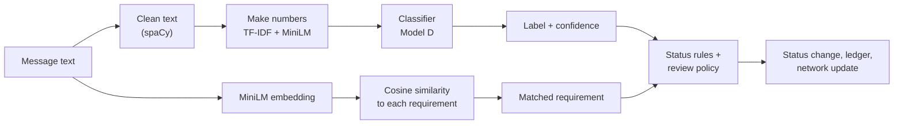
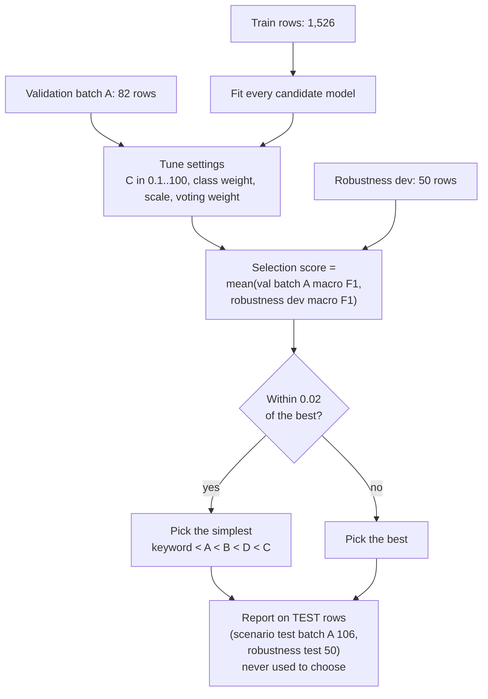

# Component 1: Models and calculations, explained simply

This is the "how does it actually work and why" companion to `component1_system_overview.md`.
Every formula and number below comes from the code (file names are given so you can check it).

**Contents**
1. [The big picture in one minute](#1-the-big-picture-in-one-minute)
2. [Data used](#2-data-used)
3. [Step 1: Cleaning the text (spaCy)](#3-step-1-cleaning-the-text-spacy)
4. [Step 2: Turning text into numbers (TF-IDF and MiniLM)](#4-step-2-turning-text-into-numbers-tf-idf-and-minilm)
5. [Step 3: The classifier models (keyword, A, B, C, D)](#5-step-3-the-classifier-models-keyword-a-b-c-d)
6. [How the model was trained, tuned and chosen](#6-how-the-model-was-trained-tuned-and-chosen)
7. [Confidence and the auto-accept rule](#7-confidence-and-the-auto-accept-rule)
8. [Matching a message to a requirement](#8-matching-a-message-to-a-requirement)
9. [Status rules](#9-status-rules)
10. [New-requirement detection maths](#10-new-requirement-detection-maths)
11. [Requirements network: similarity, Pathfinder, clusters](#11-requirements-network-similarity-pathfinder-clusters)
12. [How signals change the network](#12-how-signals-change-the-network)
13. [Baseline and alignment score](#13-baseline-and-alignment-score)
14. [Ledger hash chain](#14-ledger-hash-chain)
15. [Results in plain words](#15-results-in-plain-words)
16. [All the numbers in one table](#16-all-the-numbers-in-one-table)
17. [Honest limits](#17-honest-limits)

---

## 1. The big picture in one minute

> **In simple words:** Imagine a project manager who reads every email and chat message and updates a to-do list of requirements.
> This system does that job automatically. It (1) reads a message, (2) decides what *kind* of message it is, (3) finds which requirement the message
> is about, and (4) updates that requirement. A person only steps in when the system is not sure.
> Computers cannot understand words, so the first thing we do is change every message into **numbers**. After that, everything is simple maths.



Computers cannot read words, so the system turns each message into **numbers** in two different ways, then uses simple maths on those numbers:

| Question | Method | Where |
|---|---|---|
| What kind of message is this? | TF-IDF + MiniLM numbers, then logistic regression | `ai-service/app/signal_model.py` |
| Which requirement is it about? | MiniLM numbers, then cosine similarity | `ai-service/app/embedder.py` |
| Which requirements are related? | cosine similarity, then Pathfinder | `backend/src/modules/network/` |
| Is it a brand-new requirement? | label + confidence + similarity + new words | `backend/src/modules/signals/newRequirement.js` |
| Has the project drifted from the plan? | Jaccard score on links | `backend/src/modules/network/alignment.js` |

---

## 2. Data used

> **In simple words:** To teach the system, we gave it thousands of example messages where a human had already written the correct answer
> (for example "this message is a *Conflict*"). It is like giving a student past exam papers with the answers. We keep some papers hidden
> (the *test* set) and only use them at the end to see if the student really learned, instead of just memorising.
> The "robustness" set is a set of trickier questions written in a different style, to check the system is not fooled by new wording.

| Dataset | Size | Purpose |
|---|---|---|
| `scenario_signals.csv` | 2,298 labelled messages (Conflict 583, Expectation 583, Constraint 479, Completion 386, None 267) | Train, tune and test the classifier |
| `scenario_requirements.csv` | 114 requirements across 4 systems (SYS-RET, SYS-HMS, SYS-MBA, SYS-ULP) | Requirements to match against and build the network from |
| `robustness_test.csv` | 100 hand-written harder messages (50 `dev`, 50 `test`) | Checks the model on wording it never saw; **never trained on** |
| `new_requirement_test.csv` | dev and test rows | Evaluates new-requirement detection |
| `scenario_related_pairs.csv` | answer key of related requirement pairs | Used **only** to evaluate the network, never to build it |
| `jira_cleaned.csv` | 18,683 public Jira texts | Weakly labelled; tested and found to hurt, so **not used for training** |

Scenario split: **train 1,526, val 338, test 434** rows. Rows also carry a `batch` (A or B); batch A is the set used for tuning and the headline score.

---

## 3. Step 1: Cleaning the text (spaCy)

> **In simple words:** Before the computer counts words, we tidy the sentence. We make everything small letters and change each word to its base form
> ("deployed", "deploying" and "deploys" all become "deploy"), so the computer sees them as the same word.
> We do **not** throw away small words like *not*, *must* and *only*, because they can completely change the meaning.
> "The system must stay online" and "The system must not stay online" are opposite messages.

Function `clean_texts()` in `signal_model.py`:

1. Lowercase every word.
2. **Lemmatize** (reduce to the base word): "deployed" and "deploying" become "deploy".
3. **Keep stopwords and negations on purpose.** Words like *must, not, no, never, without, only, unless, instead, but* look unimportant but change the meaning
   ("must stay" vs "must not stay"), so they are not removed.

Only the TF-IDF part uses this cleaned text. MiniLM reads the original sentence.

---

## 4. Step 2: Turning text into numbers (TF-IDF and MiniLM)

> **In simple words:** There are two ways we turn a sentence into numbers.
> - **TF-IDF = a word counter that knows which words matter.** Common words like "the" are not useful, so they get a low score.
>   Special words like "descoped" or "signed off" are rare and tell us a lot, so they get a high score. It looks at *exact words*.
> - **MiniLM = a tool that understands meaning.** It was already trained by others on a huge amount of text. It gives each sentence a "fingerprint"
>   (384 numbers). Two sentences that *mean* the same thing get similar fingerprints, even when they use different words.
>
> We use **both**, because each one is good at something the other is bad at.

### 4.1 TF-IDF: counting important words

> **In simple words:** Score = "how often is this word in *this* message" x "how rare is this word across *all* messages".
> A word that appears a lot here but almost nowhere else is the most important one.
> We also count two-word phrases ("out of scope"), because a phrase can mean more than its separate words.

**TF-IDF** means *term frequency times inverse document frequency*. In simple words: a word scores high if it appears **often in this message** but
**rarely in other messages**.

- **TF**: how often the word appears in the message. With `sublinear_tf=True` the count is dampened (`1 + log(count)`) so repeating a word ten times does not count ten times.
- **IDF**: `log(total messages / messages containing the word)`. Common words ("the", "system") get a low score; rare, telling words ("descoped", "signed off") get a high one.
- **1-2 grams**: it counts single words **and** two-word phrases ("not allowed", "signed off", "out of scope").
- `min_df=2`: a word or phrase must appear in at least 2 training messages to be kept (removes typos and one-offs).

Result: each message becomes a long, mostly-zero list of numbers (one per word or phrase). Good at **exact wording**.
Setting used: `TfidfVectorizer(ngram_range=(1, 2), min_df=2, sublinear_tf=True)` in `training/train.py`.

### 4.2 MiniLM: capturing meaning

> **In simple words:** Think of a map. MiniLM places every sentence as a point on a map. Sentences with the same meaning are placed **close together**,
> and sentences with different meanings are far apart. "Client cancelled the feature" and "feature removed from scope" land near each other.

**all-MiniLM-L6-v2** is a small pre-trained language model. It turns a whole sentence into **384 numbers** (an *embedding*) so that sentences with similar
**meaning** have similar numbers, even with different words ("the client cancelled the feature" is close to "that feature was removed from scope").
The vectors are **normalised to length 1**, which makes comparing them simple (see section 8). Good at **meaning**.

### 4.3 Why use both

> **In simple words:** TF-IDF is like a detective who looks for exact clue words. MiniLM is like a person who understands the story.
> The detective is great when the clue words appear, and the story-reader is great when the wording is new. Together they make fewer mistakes.

| | TF-IDF | MiniLM |
|---|---|---|
| Strong at | exact trigger words and phrases ("must", "cannot", "done") | paraphrases and new wording |
| Weak at | wording it has never seen | small word differences that flip the label |

Combining them (Model D) covers both weaknesses.

---

## 5. Step 3: The classifier models (keyword, A, B, C, D)

> **In simple words:** The "classifier" is the part that reads the numbers and decides the label of the message. We built five versions and
> compared them like a competition:
> - **Keyword** = a simple list of rules ("if it says *done*, it is Completion"). This is the weakest, used only as a starting point to beat.
> - **A** = learns from the exact-word counter (TF-IDF).
> - **B** = learns from the meaning fingerprints (MiniLM).
> - **C** = A and B vote and we mix their answers.
> - **D** = one learner that looks at the word counts **and** the meaning fingerprints together. **This one was chosen.**
>
> *Logistic regression* is the learning method. It learns how much each number should push the answer toward each label, then turns that into
> five percentages that add up to 100%. The label with the biggest percentage wins.

All models output a probability for each of the 5 labels (`Constraint, Expectation, Completion, Conflict, None`).
**Logistic regression (LR)** is the classifier used inside A, B and D: it learns a weight per input number and turns the weighted sum into probabilities
with the *softmax* function, so the five probabilities add up to 1.

| Model | What it is | Idea |
|---|---|---|
| **Keyword** | about 60 regex rules, no training | Baseline: "must", "blocked", "done" and so on. Counts rule hits per label, divides by the total |
| **A** | cleaned text, TF-IDF, LR | Learns which words and phrases signal each label |
| **B** | MiniLM embedding, LR | Learns from meaning |
| **C** | soft voting `w * P(A) + (1 - w) * P(B)` | Average of A and B's probabilities (best `w` = 0.8) |
| **D** (selected) | one LR on `[TF-IDF features, scale * MiniLM embedding]` | Both feature sets in a single model |

Model D in detail (`ConcatLrModel`): the TF-IDF vector and the MiniLM vector multiplied by `scale` are glued side by side (`scipy.sparse.hstack`),
then one logistic regression predicts the label. The selected settings: **C = 100, class_weight = balanced, scale = 0.5**.

- **C** is the regularisation strength (higher = trusts the training data more, fits tighter).
- **class_weight = balanced** gives rare classes (such as None, 267 rows) extra weight so the model does not ignore them.
- **scale = 0.5** makes the MiniLM block half as loud as TF-IDF, so neither dominates.

---

## 6. How the model was trained, tuned and chosen

> **In simple words:** We split the example messages into three piles, like school work:
> - **Train** (1,526 messages) = the lessons the system studies.
> - **Validation** (a smaller pile) = practice tests used to adjust the settings.
> - **Test** (kept hidden) = the final exam, used only once at the end.
>
> We never choose the model by looking at the final exam, because that would be cheating. We also use the separate "robustness" messages as a
> second practice test, to prefer a model that handles new wording. If two models score almost the same, we pick the **simpler** one, because
> simple models are easier to explain and less likely to be lucky by chance.
>
> **Macro F1** is the score. It is a number from 0 to 1 (1 is perfect). It checks each label separately and averages them, so a model cannot
> get a good score by doing well only on the most common label.
> - *Precision* = when the system says "Conflict", how often is it right?
> - *Recall* = of all the real Conflicts, how many did the system find?

`ai-service/training/train.py`. The rules were set up to avoid cheating (testing on data the model learned from):



- **Search grid:** `C` in {0.1, 0.3, 1, 3, 10, 30, 100}, class weight {none, balanced}, D's `scale` in {0.5, 1, 2}, C's weight 0.0 to 1.0 in steps of 0.1.
- **Macro F1** (the main score): for each label compute F1 = `2 * precision * recall / (precision + recall)`, then average the five labels equally.
  It treats every label as equally important, which suits uneven classes.
  - *Precision*: of the messages predicted as this label, how many were right.
  - *Recall*: of the messages that truly have this label, how many were found.
- **Tie rule:** D and C were within 0.02 of each other (selection score 0.787 best), so the simpler one, **D**, was kept.
- **Confidence intervals:** test scores come with a 95% **bootstrap** interval (resample the test rows many times and see how much the score moves).
- Trained model is saved as `ai-service/models/<version>/model.joblib` with `metadata.json`; `current.json` names the active version
  (currently `20261020T110553Z`). Only the classifier and the MiniLM **name** are saved, not the large transformer weights.
- `training.promote` checks a candidate before it becomes the active model.

**Retraining with PM feedback:** accepted and corrected signals are exported (`GET /feedback/export`) and can be added with `--extra-data`.

---

## 7. Confidence and the auto-accept rule

> **In simple words:** *Confidence* is how sure the system is, from 0 to 100. If the system thinks "90% Conflict, 5% Constraint, ..." the label is
> Conflict and the confidence is 90. But note: confidence is only a **feeling of certainty**, not a promise. A system can be very sure and still wrong.
>
> **Auto-accept** means the system is allowed to act without asking a person. We only allow that when it is very sure (90 or more), it found the
> requirement, and the change is not dangerous (like dropping a requirement). In every other case it puts the message in a **pending** list and
> waits for the project manager (PM) to say yes or no. This keeps the PM in control while still saving time.
>
> We measured it: at 90+ confidence, the system was right 94 out of 100 times. That is good, but slightly under our 95% goal, so we are honest about it.

- **Confidence** = the highest of the five probabilities, converted to a whole number: `round(probability * 100)`, clamped to 0 to 100 (`reviewPolicy.js`).
  Example: probabilities 0.91 / 0.05 / 0.02 / 0.01 / 0.01 give label = first one, confidence = **91**.
- The model's confidence is **not a true probability of being right**; it is only a score. That is why we measured it (below).

**Auto-accept** (no human needed) only when **all** are true:

1. confidence >= 90 (`AUTO_ACCEPT_CONFIDENCE`)
2. label is not None
3. a requirement was matched, and if matched by similarity (not chosen by the user) similarity >= 0.40
4. the proposed status is not a move into **Dropped**
5. it is not flagged as a possible new requirement

Otherwise the signal stays **pending** for a PM. The reason is recorded: `low-confidence`, `unmapped`, `low-similarity`, `proposes-drop`, `new-requirement` or `unclassified`.

**How safe is the 90 threshold?** On the dev data, signals at confidence >= 90 were right **94%** of the time and made up **41%** of predictions.
The team's target was 95%, which no threshold reached, so the report does not claim a recommended threshold; 90 is a cautious default.

---

## 8. Matching a message to a requirement

> **In simple words:** To find which requirement a message is about, we compare the message's "fingerprint" with the fingerprint of every requirement
> and pick the most similar one. The similarity score is called *cosine similarity*. It is simply a number that says how much two fingerprints
> point in the same direction. Higher = more alike.
>
> We also set two safety limits: if the best match scores below **0.30**, we say "no requirement found" instead of guessing.
> And to let the system act alone, the match must score at least **0.40**. Below that, a person checks it.

Because MiniLM vectors have length 1, **cosine similarity is just the dot product**:

```
similarity(a, b) = a . b  = sum of (a_i * b_i)         range about -1 to 1, higher = more similar
```

- The requirement text is `title + description`. The message is compared to every requirement in the project; the top results (with the top 3 shown as alternatives) are returned.
- `/match/batch` does the same for many messages at once (documents).
- **Thresholds** (backend env, defaults):

| Setting | Value | Meaning |
|---|---|---|
| `MATCH_MIN_SIMILARITY` | 0.30 | Below this no requirement is proposed at all; signal stays unmapped and pending |
| `AUTO_APPLY_MIN_SIMILARITY` | 0.40 | A similarity match must reach this to be auto-accepted |

If the user gives an explicit `requirementId`, matching is skipped and the 0.40 rule does not apply (a person chose it).

---

## 9. Status rules

> **In simple words:** Once we know the kind of message, the status change is a fixed rule, like a traffic light.
> An *Expectation* ("we need X") or *Completion* ("X is done") makes the requirement **Confirmed**. A *Constraint* ("X must only...") makes it **Modified**.
> A *Conflict* ("X is blocked") makes it **At Risk**. If a conflict message says the feature was removed, postponed or cancelled, the status becomes
> **Dropped**, and a person must always approve that. Once something is Dropped, it stays Dropped.

`statusEngine.js` is a plain lookup table (no maths):

| Label | New status |
|---|---|
| Expectation | Confirmed |
| Completion | Confirmed |
| Constraint | Modified |
| Conflict | At Risk |
| Conflict containing *dropped, removed from scope, descoped, out of scope, postponed, cancelled, deferred, taken out* | Dropped |
| None | no change |

**Dropped is final**: later signals are saved but do not change the status. A proposed drop is never auto-accepted, so a PM always confirms it.

---

## 10. New-requirement detection maths

> **In simple words:** Sometimes a message asks for something **completely new** that is not in our list, for example "please add a Koko payment option".
> The matcher would still link it to the nearest old requirement, which would be wrong. So we added a checker with simple questions:
> 1. Does it sound like a request (Expectation)? 2. Is the system fairly sure (70+)? 3. Is it **not similar** to anything we already have (below 0.35)?
>
> There is also a clever second test: if it is *somewhat* similar (0.35 to 0.50) but contains a **brand-new word** nobody used before (like "koko"),
> we still treat it as new. If it looks new, it is **never applied automatically**. It goes to the PM as a *candidate*, and the PM chooses
> approve, merge with an existing requirement, or reject. Similar messages are grouped together so the PM sees one candidate with all the evidence.

`newRequirement.js`. The classifier is untouched; the detector looks at its output plus the matcher's similarity.

A signal becomes a **candidate** when:

1. label = **Expectation**, and
2. confidence >= **70**, and
3. it is not a seeded row, and
4. it looks novel, which means either
   - **(a)** top similarity < **0.35** (nothing in the project is close), or
   - **(b)** top similarity from 0.35 up to **0.50** *and* the text has a **novel token**.

**Novel token:** a content word (at least 4 letters) that appears in **no requirement text** and in **at most 2 earlier signals** of the project.
Example: "koko" in "add koko payment option" → reason `new terms: koko`. Rule (b) rescues messages that borrow words from an existing requirement
(so similarity looks medium) but introduce something new.

**Grouping** (cosine of MiniLM embeddings; a candidate's centre is the average of its signals):

| Cosine to... | Action |
|---|---|
| a **pending** candidate >= 0.60 | add this signal as more evidence |
| a **rejected** candidate >= 0.80 | store the signal as pending, no candidate (suppressed) |
| otherwise | start a new candidate |

**Why rule (b) matters** (from `docs/new_requirement_detection.md`): with only rule (a), recall was 6.3% on dev and 0% on test; with rule (b), recall is 81.3% (dev) and 62.5% (test) while precision stays 100%.

---

## 11. Requirements network: similarity, Pathfinder, clusters

> **In simple words:** The network map is a picture that shows **which requirements are related**. Requirements are dots, and a line between two dots
> means "these two are closely related".
>
> If we drew a line between every pair, the picture would be a messy black ball. So we use **Pathfinder**, which removes the unnecessary lines.
> The idea is: if you can go from A to C through B using only strong steps, then the direct A-C line is not needed. What stays is the "skeleton" of the strongest relationships.
>
> **Clustering** puts related requirements into groups (like sorting books into shelves) and gives each group a name from its most special words.

### 11.1 Similarity and distance

> **In simple words:** Similarity says "how alike". Distance says "how far apart". They are opposites: `distance = 1 - similarity`. Very alike = very close.
Each requirement's `title + description` is embedded with MiniLM (cached). For every pair:

```
textSim = cosine(embedding_i, embedding_j)
distance = 1 - similarity            (small distance = closely related)
```

### 11.2 Pathfinder: keep only the strongest links

> **In simple words:** Think of three towns. A to C is a long road (70 km). But A to B is 30 km and B to C is 40 km. You never need the direct 70 km road,
> because going through B only has steps of 40 km at most. Pathfinder deletes the direct road. What is left is the main network of strongest connections.
With n requirements there are n(n-1)/2 possible links, far too many to draw. **Pathfinder PFNET (r = infinity, q = n - 1)** removes a direct link
if there is an indirect route whose **every step is shorter**.

Plain example: A-C distance 0.7, but A-B is 0.3 and B-C is 0.4. The route A→B→C has a longest step of 0.4, which is less than 0.7, so the direct A-C link is dropped.

How the code does it (`pathfinder.js`):
1. For every pair compute the **minimax path distance** `D(i, j)`: over all routes, the route whose **largest** step is smallest. Computed with a Floyd-Warshall loop using `max` instead of `+`.
2. Keep edge (i, j) only if `d(i, j) <= D(i, j)` (plus a tiny float tolerance); ties are kept.

On a fully connected graph this keeps roughly **n - 1 edges** (it is the union of the minimum spanning trees), so the map shows the backbone of strongest relationships, not every related pair.

### 11.3 Clustering: grouping requirements

> **In simple words:** Start with every requirement alone. Join the two that are closest. Keep joining the closest groups, again and again, until only a few groups remain.
> How many groups? About the square root of the number of requirements, but never fewer than 3 or more than 8, so the screen stays easy to read.
> (We picked this for usability. We did **not** adjust it to match the answer key, because that would be cheating.)
**Average-linkage agglomerative clustering** on the same distances (`clustering.js`):

1. Start with every requirement as its own cluster.
2. Repeatedly merge the two clusters whose **average pairwise distance** is smallest.
3. Stop when exactly **k** clusters remain: `k = clamp(round(sqrt(n)), 3, 8)`, never more than n.
   Examples: n = 23 or 26 → 5 clusters; n = 31 or 34 → 6.
4. Clusters are numbered by size (largest first) so results are stable.

**Cluster label:** the two most distinctive title words, scored `termFrequencyInCluster * (1 + ln(numberOfClusters / clustersContainingTheWord))` (a TF-IDF-style score),
giving names like "Cluster 1 (payments, card)".

**k was chosen for usability, not tuned on the answer key.** An older distance-cut version (cutoff 0.6) produced 18 clusters for 31 requirements, which was too many for a UI.

---

## 12. How signals change the network

> **In simple words:** At first, the map is built only from what the requirement descriptions say. But real messages teach us more. If people keep
> mentioning two requirements together, they are probably related, even if their descriptions look different. So each accepted message
> adds a little evidence, and the map slowly updates itself. We store three kinds of clues:
> - **Profile** = a "what people say about this requirement" summary that gets updated with each new message (new messages count 15%, the old summary 85%).
> - **Id mention** = the message literally names two requirement ids, like "RET-R04 is blocked by RET-R07". This is strong proof.
> - **Co-reference** = the matcher found two requirements equally close to the message, so it is probably about both. This is weaker proof.

When a signal is **applied** (auto-accepted or PM accepted/corrected, not None, not seeded), `finalizeSignal()` adds evidence. Three ingredients:

### 12.1 Signal profile (what the messages say about a requirement)
A running average of the embeddings of all signals applied to a requirement (an exponential moving average):

```
profile = normalize( 0.85 * oldProfile + 0.15 * newSignalEmbedding )
```
Recent messages gradually shift the profile; older ones fade. The first signal starts the profile directly.

### 12.2 Evidence rows
- **idmention**: the text names requirement ids, e.g. "RET-R04 is blocked by RET-R07" → a link between them (strong evidence).
- **coref** (co-reference): the top two match candidates are both >= 0.40 similar **and** within 0.10 of each other → the message is probably about both.

### 12.3 Combined similarity of a pair

> **In simple words:** The final closeness of two requirements is a mix of three things: what their **descriptions** say, what **people's messages** say about them, and
> any **direct clues**. The more messages we have about both requirements, the more we trust the messages (up to 35% of the score). Direct id mentions
> add the most bonus points, co-references add a smaller bonus, and the total bonus can never go above 0.35. The final score never goes above 1.

```
w      = 0.35 * min(1, min(count_i, count_j) / 10)        (0 if either has no profile)
boost  = min(0.35,  min(0.30, 0.15 * idMentions) + min(0.20, 0.06 * corefs))
sim    = min(1,  (1 - w) * textSim  +  w * profileSim  +  boost)
```

Reading it simply:
- Start from text similarity. As more signals back **both** requirements, up to **35%** of the score shifts to how the messages describe them (`w` reaches its maximum at 10 signals on the thinner side).
- Each explicit id mention adds **0.15** (max 0.30); each co-reference adds **0.06** (max 0.20); the total boost is capped at **0.35**. An id mention is worth more than an inference.
- The result is capped at 1.

`GET /network` returns for each link `weight`, `evidenceCount` and `contributions { text, profile, boost }` so the UI can show *why* two requirements are linked.

Pathfinder is rerun on this combined matrix. Only **added or removed** links are written, and one `NETWORK_UPDATE` ledger entry records them.
All these constants are **a-priori choices** (fixed by evidence strength), **not tuned on the answer key** (`network/constants.js`).

---

## 13. Baseline and alignment score

> **In simple words:** A *baseline* is a photo of the network on a chosen day, like "the plan we agreed". Later, we compare today's network with that photo.
> The **alignment score** answers: "how much of the picture is still the same?" It goes from 0 to 100.
>
> The formula (Jaccard) is: **links in both pictures divided by links in either picture, times 100**.
> Example: the photo had 30 links and today has 30 links, and 24 of them are the same. Links in either picture = 36. Score = 24 / 36 x 100 = **67**.
> A high score means the project still matches the plan. A low score means it has **drifted**, so the PM should look at what changed.

- A **baseline** is a snapshot of the links at an agreed moment (the first one uses text only, no signals).
- The **alignment score** compares today's links with the baseline using the **Jaccard index**:

```
score = round( 100 * |B ∩ C| / |B ∪ C| )
   B = baseline links, C = current links (undirected, computed links only; manual links excluded)
```

| Score | Band |
|---|---|
| 80 to 100 | Strong Alignment |
| 60 to 79 | Moderate Drift |
| below 60 | Significant Drift |

**Example:** baseline has 30 links, today 30 links, 24 are the same → union = 30 + 30 - 24 = 36 → score = round(100 * 24 / 36) = **67** → Moderate Drift.
If both sets are empty the score is 100.

**History chart:** replays the `NETWORK_UPDATE` ledger entries after the baseline day by day (Asia/Colombo days, UTC+5:30, last 90 days). Each day's score
is the Jaccard value at the end of that day; days with no change repeat the previous value. A day names a **driver signal** (the signal behind the biggest change)
only if at least 2 links changed that day.

Approving a new requirement adds links, so it lowers the score until a new baseline is frozen.

---

## 14. Ledger hash chain

> **In simple words:** The ledger is a diary of everything that changed, and it is built so nobody can secretly edit it.
> Each diary page gets a "seal" (called a hash) made from its content **plus the seal of the previous page**. If someone changes an old page,
> its seal no longer matches, and every page after it breaks too. The *verify* button recalculates all the seals and tells you the first broken page.
> It works like a chain of locked boxes. (Today it is a practice version stored in the database. A real blockchain can replace it later.)

Each ledger entry stores:

```
txHash = "0x" + SHA-256( canonicalJSON(entry fields) + previousBlockHash )
```
- *Canonical JSON* means fixed key order, missing values as `null`, ISO timestamps, so the same entry always gives the same hash.
- `previousBlockHash` is the previous entry's `txHash` (the first block uses 0). `blockNumber` counts up per project.
- If any old entry is edited, its hash changes and **every later entry stops matching**. `GET /ledger/verify` recomputes the whole chain and returns
  `{ valid, entries, brokenAt }`, where `brokenAt` is the first entry that does not match.

This is a **tamper-evident log**, not yet a real blockchain: entries are flagged `isPlaceholder: true`, `onChain: false`, and one function (`appendLedgerEntry`) is the single place a real chain will plug in.

---

## 15. Results in plain words

> **In simple words:** The chosen model gets about **90 out of 100** on messages that look like its training data, and about **71 out of 100** on tricky,
> differently worded messages. Simple rules alone get only 59 and 21, so the machine learning clearly helps. These test sets are small, so the numbers
> are estimates with a margin of error, and we show that margin as the *95% interval*.

| What was measured | Result | In plain words |
|---|---|---|
| Classifier, scenario test (106 messages) | macro F1 **0.897** (95% CI 0.840 to 0.947) | Very good on messages that look like the training data |
| Classifier, harder robustness test (50 messages) | macro F1 **0.714** (CI 0.566 to 0.832) | Noticeably weaker on unfamiliar wording |
| Keyword baseline | 0.591 and 0.207 | Rules alone are not enough, so the ML is worth it |
| Model A (TF-IDF only) | 0.874 and 0.671 | Strong on familiar text, weak on new wording |
| Model B (MiniLM only) | 0.683 and 0.814 | The reverse: weak on familiar text, strong on new wording |
| Model D (both) | 0.897 and 0.714 | Best overall balance, and the simplest model within tolerance of the best |
| Auto-accept at confidence >= 90 (dev) | 94% right on 41% of messages | Close to, but under, the 95% target |
| New-requirement detection (dev / test) | precision 100%, recall 81.3% / 62.5% | Never raised a false alarm in the test sets, but misses some new requirements |
| Network vs the answer key | modest agreement | Good as a visual aid; not a proof of ground-truth structure |

All test sets are small (50 to 106 rows), so differences under about 0.03 macro F1 are noise.

---

## 16. All the numbers in one table

> **In simple words:** This is a cheat sheet. Every number the system uses is in one list, with the file where you can change it.
> Most of these numbers were chosen by reasoning (a-priori), not by tuning them until a result looked good.

| Setting | Value | File |
|---|---|---|
| Labels | Constraint, Expectation, Completion, Conflict, None | `signal_model.py` |
| Embedding model | all-MiniLM-L6-v2 (384 numbers, length 1) | `signal_model.py` |
| TF-IDF | 1-2 grams, min_df 2, sublinear TF | `train.py` |
| Model D | C 100, balanced, scale 0.5 | model `metadata.json` |
| Tie margin between models | 0.02 | `train.py` |
| Confidence | round(max probability * 100) | `reviewPolicy.js` |
| Auto-accept confidence | 90 | env `AUTO_ACCEPT_CONFIDENCE` |
| Match minimum similarity | 0.30 | env `MATCH_MIN_SIMILARITY` |
| Auto-apply minimum similarity | 0.40 | env `AUTO_APPLY_MIN_SIMILARITY` |
| New-requirement min confidence | 70 | `newRequirementConstants.js` |
| New-requirement similarity low / high | 0.35 / 0.50 | same |
| Novel token | length >= 4, in no requirement, <= 2 earlier signals | same |
| Candidate group / suppress similarity | 0.60 / 0.80 | same |
| Clusters k | clamp(round(sqrt n), 3, 8) | `clustering.js` |
| Signal profile | 0.85 old + 0.15 new | `network/constants.js` |
| Profile max weight / full count | 0.35 / 10 signals | same |
| Boost per id mention / cap | 0.15 / 0.30 | same |
| Boost per co-reference / cap | 0.06 / 0.20 | same |
| Boost total cap | 0.35 | same |
| Co-reference min similarity / max gap | 0.40 / 0.10 | same |
| Alignment bands | >= 80 strong, 60-79 moderate, < 60 significant | same |
| History window | 90 days, Asia/Colombo | same |
| Document limits | 2 MB file, 300 segments, 100 per bulk save | signals module |

---

## 17. Honest limits

> **In simple words:** No system is perfect. This list says clearly where ours can be wrong, so nobody trusts it more than it deserves.

- The classifier's **confidence is not calibrated**, and no threshold reached 95% precision on the dev data.
- Test sets are **small**, so results have wide error bars (see the confidence intervals).
- The model is trained on **generated scenario data**; real project chat may read differently (the robustness set shows the drop to 0.714).
- Matching always finds the **closest existing** requirement; the new-requirement detector reduces but does not remove wrong matches for genuinely new topics.
- Pathfinder shows about **n - 1** links, the strongest backbone, not every related pair.
- Network constants are **a-priori**, not tuned, so they may not be optimal; on the scenario replay, signals made no clear difference to the network.
- The ledger is a **hash chain placeholder**, not a blockchain.
- Retraining is **manual** (export feedback, train, promote).
