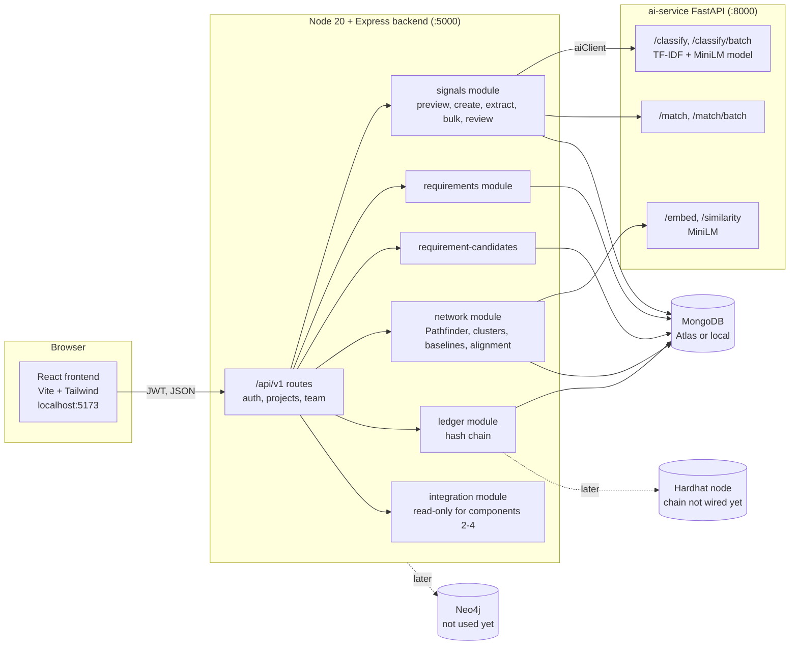
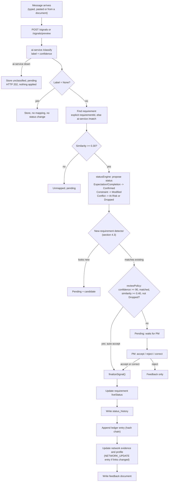
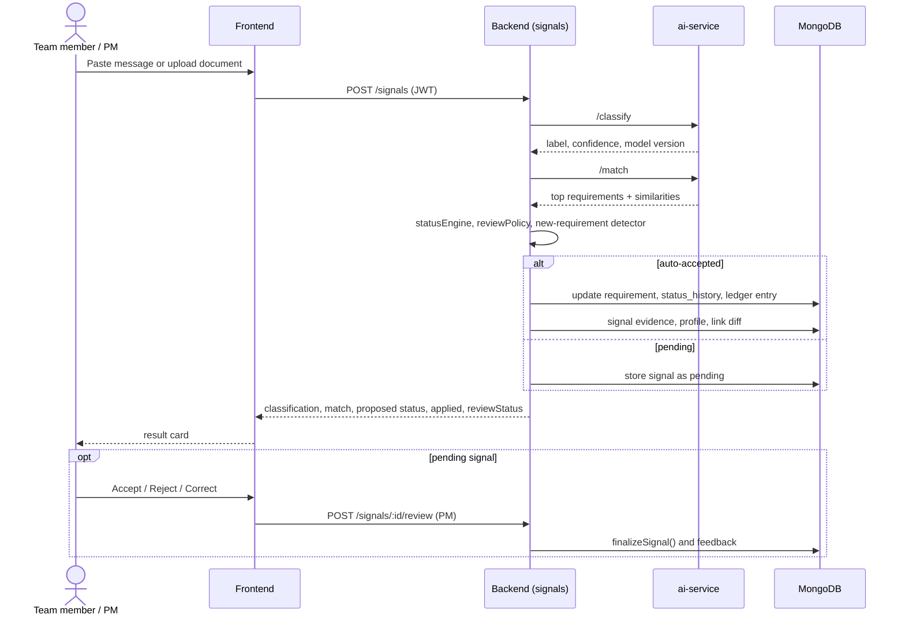
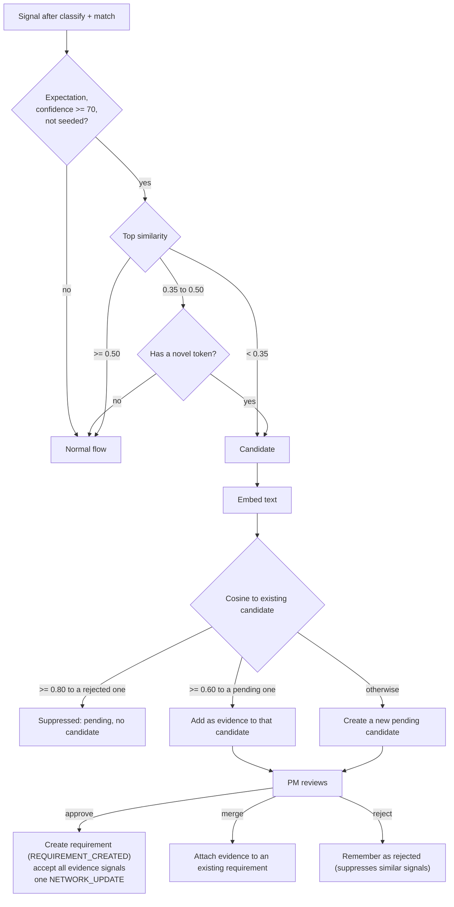
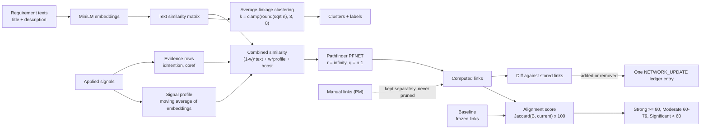
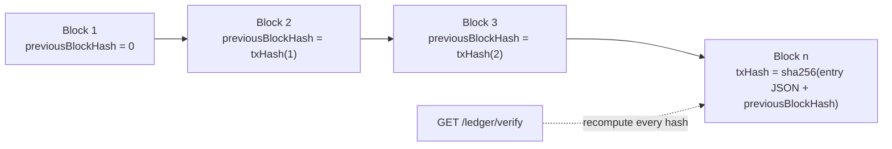
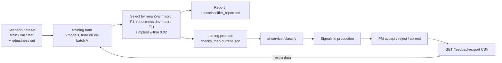

# Component 1: Living Requirements Engine, full system overview

This document lists every feature already built for Component 1, how the parts connect, and the end-to-end flow, with diagrams.
It is based on the code, `README.md`, `docs/` and `ai-service/training/README.md` as they are now.

**Contents**
1. [What Component 1 does](#1-what-component-1-does)
2. [Architecture](#2-architecture)
3. [Feature catalogue](#3-feature-catalogue)
4. [Flow diagrams](#4-flow-diagrams)
5. [TF-IDF: where it is used](#5-tf-idf-where-it-is-used)
6. [Data model](#6-data-model)
7. [API summary](#7-api-summary)
8. [Frontend screens](#8-frontend-screens)
9. [Evaluation results](#9-evaluation-results)
10. [Testing and how to run](#10-testing-and-how-to-run)
11. [Known limitations and TODO](#11-known-limitations-and-todo)

---

## 1. What Component 1 does

Project teams talk in emails, stand-ups, chats and documents. Requirements change in those messages, but the requirement list is
usually not updated. Component 1 keeps the requirement list **live**:

1. It reads a message (a *signal*) and **classifies** it: Expectation, Constraint, Completion, Conflict or None.
2. It **maps** the message to the existing requirement it is about.
3. It **updates the requirement status** (Confirmed, Modified, At Risk, Dropped), after a PM review when the system is not confident.
4. It records every change in a tamper-evident **ledger**.
5. It builds a **requirements network map** (which requirements are related) and measures how far it **drifts** from an agreed baseline.
6. It spots messages that describe a **brand-new requirement** and offers them to the PM.

The other three components (Gap Detection, Schedule Re-Optimization, Retrospective Intelligence) read Component 1's data through
read-only integration endpoints.

---

## 2. Architecture



| Service | Technology | Role |
|---|---|---|
| frontend | React, Vite, Tailwind, React Flow (network map) | PM and team UI |
| backend | Node 20, Express, Mongoose, zod, JWT | All business logic, the only service that touches MongoDB |
| ai-service | FastAPI, scikit-learn, spaCy, sentence-transformers (all-MiniLM-L6-v2) | Classification, embeddings, matching |
| MongoDB | Atlas by default, local container optional | Persistent data |
| neo4j, hardhat | Docker containers | Reserved for later (graph store, real blockchain); not used by the code yet |

The backend talks to the ai-service only through `backend/src/shared/aiClient.js`. If the ai-service is down, signals are stored as
unclassified and `pending` (API answers 202) and nothing is applied.

---

## 3. Feature catalogue

### 3.1 Signal classification (ai-service)
- Five classes: **Expectation, Constraint, Completion, Conflict, None**.
- Five candidate models were trained and compared: a keyword-rule baseline, **A** (TF-IDF + logistic regression), **B** (MiniLM + logistic
  regression), **C** (soft voting of A and B) and **D** (one logistic regression on TF-IDF and MiniLM features together).
- The selected model is **D**, version `20261020T110553Z` (see [section 5](#5-tf-idf-where-it-is-used)).
- Returns a label and a confidence (highest class probability, stored as an integer 0 to 100) and the model version.
- Single (`/classify`) and batch (`/classify/batch`) endpoints; the batch endpoint is used for documents.
- Training pipeline (`ai-service/training`): train, evaluate, `promote` a candidate model after checks, a Jira review sample builder and a
  hand-label evaluation, and `analyze_pipeline` for end-to-end evidence. Models are versioned in `ai-service/models/<version>/`, and
  `current.json` points to the active one.
- Retraining data comes from PM feedback: `GET /feedback/export` returns a CSV that `training.train --extra-data` accepts.

### 3.2 Requirement matching (ai-service)
- `/embed` gives normalised MiniLM vectors, `/similarity` compares two texts, `/match` and `/match/batch` rank the project's requirements
  (title + description) against a message and return the best matches with similarity scores.

### 3.3 Signal ingestion pipeline (backend `signals`)
- **Create** `POST /projects/:id/signals` (any member): classify, match, propose a status, apply or hold for review.
- **Preview** `POST /signals/preview`: the same answer, nothing saved (dry run).
- **Explicit requirement** (`requirementId`) skips matching.
- **Match thresholds:** `MATCH_MIN_SIMILARITY` (0.30) decides whether a requirement is proposed at all; `AUTO_APPLY_MIN_SIMILARITY` (0.40)
  decides whether a similarity-matched signal may be auto-accepted.
- **Top-3 alternatives** of the match are returned so a PM can correct a wrong mapping.
- **Graceful degradation** when the ai-service is down (202, stored unclassified and pending).

### 3.4 Status engine (`statusEngine.js`, pure and unit-tested)

| Signal label | Proposed status |
|---|---|
| Expectation | Confirmed |
| Constraint | Modified |
| Conflict | At Risk |
| Completion | Confirmed |
| Conflict with a drop phrase (dropped, removed from scope, descoped, out of scope, postponed, cancelled, deferred, taken out) | **Dropped** |
| None | no change |

`Dropped` is terminal: later signals are stored but change nothing.

### 3.5 Review policy (`reviewPolicy.js`, pure and unit-tested)
A signal is auto-accepted only if **all** hold: confidence >= `AUTO_ACCEPT_CONFIDENCE` (default 90), label is not None, a requirement was
matched with enough similarity, and the proposal is not a move into Dropped. Everything else is `pending` and changes nothing until a PM
decides. A `None` signal above the threshold is accepted with no effect.

### 3.6 PM review and feedback loop
- `POST /signals/:id/review` (PM only): **accept**, **reject** or **correct** (corrected label and/or requirement, plus a note).
- Every action writes a `feedback` document. `GET /feedback/export` (PM only) produces training CSV (`text,label,source,role`),
  de-duplicated, seeded rows left out.
- One function, `finalizeSignal()` (`signals/finalize.js`), finalises every applied signal (status, history, ledger, feedback, network
  update) and is shared by preview, create, bulk and review.

### 3.7 Document analysis (SRS, emails, meeting notes)
- `POST /signals/extract`: upload `.txt`, `.md`, `.docx` or `.pdf` (2 MB max) or send JSON text.
- **Segmentation** (`segmentation.js`, unit-tested): splits into statements; ignores email headers, greetings, sign-offs and short lines;
  turns a leading `Name:` into `speakerLabel`; removes duplicates; at most 300 segments (else 413).
- Text extraction: `mammoth` for DOCX, `unpdf` for PDF. The file is processed in memory, never stored, never logged.
- Classifies the whole document in one batch call and matches the non-None segments in another; returns each segment with label, match,
  proposed status and `wouldAutoApply`. **Saves nothing.**
- `POST /signals/bulk`: saves the approved items (max 100) in order through the normal flow, tags each with `sourceDocument`, and returns
  `{ applied, pending, noChange, failed }`. Re-using a `documentId` is a 409 unless `force: true`; if the ai-service is down nothing is saved.

### 3.8 Requirements management
- List, get, **create** (PM) and **update** (PM) requirements, with auto-generated ids (`RET-R04` style), granularity, resource role (the most
  frequent author role among its signals) and live status.
- Status history for every requirement (`status_history`).
- Clusters endpoint (`GET /requirements/clusters`).
- Creating or editing a requirement triggers an incremental network update.

### 3.9 Requirements network map
- Each requirement is embedded (title + description) with MiniLM; vectors are cached on the requirement.
- Distance = 1 - cosine similarity. **Pathfinder PFNET(r = infinity, q = n - 1)** keeps an edge only when no indirect path has all edges
  shorter, so only the strongest structural links remain (`pathfinder.js`, unit-tested).
- **Clustering:** average-linkage agglomerative clustering cut to k = clamp(round(sqrt(n)), 3, 8) clusters. Each cluster gets a label made of
  its two most distinctive title words. `group_id` from the dataset is never used to form or name clusters.
- **Incremental updates:** only the changed requirement is re-embedded, Pathfinder is rerun, and only added or removed links are written.
  One `NETWORK_UPDATE` ledger entry is written if anything changed.
- **Manual links** (PM only): add or remove links between requirements; stored separately and never pruned by a recompute.
- **Full recompute** (PM only): `POST /network/recompute`, or `npm run network:build` for every project.
- Link details: `GET /network/links/:id/evidence` lists the text, profile and boost contributions and up to 20 supporting signals.
- Frontend: interactive map with zoom, cluster colours and background nodes, Pathfinder edges, manual-link edges, a requirement detail panel and
  a link details panel.

### 3.10 Signals feed the network (evidence and signal profile)
When a signal is **applied** (auto-accepted or accepted/corrected by a PM, label not None, not seeded), `finalizeSignal()` updates the network:
- **Evidence** rows (`signal_evidence`): `idmention` (the text names requirement ids such as `RET-R04`) and `coref` (the top two match
  candidates are both similar enough and close to each other).
- **Signal profile:** a moving average of the embeddings of the signals applied to a requirement, `profile = normalize(0.85 * profile + 0.15 * embedding)`.
- **Combined similarity:** `sim = (1 - w) * textSim + w * profileSim + boost` where `w = 0.35 * min(1, min(count_i, count_j) / 10)` and the boost is
  0.15 per id mention (cap 0.30) and 0.06 per co-reference (cap 0.20), total cap 0.35.
- If the ai-service is down the signal still succeeds, the network is marked stale and catches up on the next read.

### 3.11 Baselines and alignment score
- **Baseline:** a frozen copy of the computed links and requirement states. The *Initial baseline* is created automatically (text-only network).
  A PM can freeze more with `POST /baselines { name }`.
- **Alignment score** = round(100 * |B and C| / |B or C|) over the computed-link sets (Jaccard). Bands: **>= 80 Strong Alignment, 60 to 79 Moderate
  Drift, < 60 Significant Drift**.
- A **daily history** (Asia/Colombo days, max 90) is rebuilt by replaying `NETWORK_UPDATE` ledger entries after the baseline.
- Frontend: alignment score page with a trend chart and a baseline strip.

### 3.12 New-requirement detection (requirement candidates)
- The classifier is unchanged. A detector (`newRequirement.js`, pure and unit-tested) sits on top of the label, confidence and match similarities.
- **Rule:** Expectation, confidence >= 70, not seeded, and top similarity < 0.35, or < 0.50 with at least one *novel token* (a content word that
  appears in no requirement and in at most 2 earlier signals).
- Candidate signals are **always pending**, never auto-accepted.
- **Grouping:** cosine >= 0.60 to a pending candidate attaches the signal as more evidence; >= 0.80 to a rejected candidate suppresses it (stored
  pending, hidden from the default list).
- **PM actions** (`POST /requirement-candidates/:id/review`): **approve** (creates the requirement, writes `REQUIREMENT_CREATED`, accepts all
  evidence signals), **merge** into an existing requirement, or **reject**. Claims are atomic, so concurrent calls give one winner and 409 for the rest.
- Candidate feedback is kept separate from classifier retraining data.
- Frontend: Candidates panel and a "new requirement" tag on signal results.

### 3.13 Ledger (tamper-evident history)
- Every status change, requirement creation, manual link, network update and baseline is an entry: `STATUS_CHANGE`, `REQUIREMENT_CREATED`,
  `MANUAL_LINK`, `NETWORK_UPDATE`, `BASELINE_CREATED`.
- Each entry has a per-project `blockNumber`, `previousBlockHash` and `txHash = sha256(canonical JSON + previousBlockHash)`.
- `GET /ledger/verify` recomputes the chain and returns `{ valid, entries, brokenAt }`; `GET /ledger/requirements/:id` gives one requirement's history.
- All writes go through `appendLedgerEntry()`, the single place a real blockchain provider will replace.
- **These are placeholders, not blockchain transactions** (`onChain: false`, `isPlaceholder: true`). `npm run rechain` rebuilds old seed chains and
  refuses once API-created entries exist.
- Frontend: ledger table and a transaction detail modal.

### 3.14 Signal analytics (frontend)
Classification distribution chart, confidence trend, source breakdown, and a signal feed with result cards (label, confidence meter, matched
requirement, proposed status, review state).

### 3.15 Platform features
- **Auth:** register, login (JWT), `/me`; roles `PM` and `TeamMember`; `requireAuth`, `requireRole`, `requireProjectMember`.
- **Projects and team:** list and create projects (PM), add or remove team members (PM); one user can belong to several projects.
- **Validation and errors:** every body validated with zod; one central error handler; all responses are `{ success, data, error }`.
- **Swagger** docs at `/api/docs`; **health** at `/health`.
- **Integration contract** for other components: `live-state`, `network`, `ledger`, `schedule-baseline` (stub) and `requirement-candidates`.
- **Seed** (`npm run seed`): four demo projects (SYS-RET, SYS-HMS, SYS-MBA, SYS-ULP), users, requirements, signals, status history and a ledger chain; leaves 12
  signals pending for the Accept/Reject demo. Safe to run twice.
- **Docker Compose** with neo4j, hardhat, ai-service, backend, optional local mongo and test/train profiles.

---

## 4. Flow diagrams

### 4.1 Main flow: signal to ledger



### 4.2 Sequence: one signal end to end



### 4.3 New-requirement detection



### 4.4 Network, baseline and alignment



### 4.5 Document analysis

```mermaid
flowchart LR
    F["File .txt .md .docx .pdf<br/>or pasted text"] --> X["Extract text<br/>(mammoth, unpdf, in memory)"]
    X --> SEG["Segment into statements<br/>drop headers, greetings, short lines, duplicates"]
    SEG --> CB["/classify/batch"]
    CB --> MB["/match/batch for non-None"]
    MB --> PV["Preview table<br/>label, match, status, wouldAutoApply"]
    PV --> PM["PM selects items"]
    PM --> BK["POST /signals/bulk<br/>(max 100, normal flow per item)"]
    BK --> OUT["applied / pending / noChange / failed"]
```



### 4.6 Ledger hash chain



### 4.7 Model training and feedback loop



---

## 5. TF-IDF: where it is used

TF-IDF is used **only in the signal classifier** in the ai-service (`ai-service/app/signal_model.py`, `ai-service/training/train.py`).
It is not used for matching or the network map, which use MiniLM embeddings.

| Where | How TF-IDF is used |
|---|---|
| **Model A** (`TfidfLrModel`) | spaCy lowercase and lemmatize (stopwords and negations kept), `TfidfVectorizer(ngram_range=(1, 2), min_df=2, sublinear_tf=True)`, then logistic regression |
| **Model D** (`ConcatLrModel`, the **selected model**) | One logistic regression on `[TF-IDF features | scale * MiniLM embedding]` (scale 0.5, C 100, class weight balanced) |
| **Model C** (voting) | Soft vote of Model A (TF-IDF) and Model B (MiniLM), weight 0.8 on A |

**The feature it develops:** the *signal classification* feature (Expectation, Constraint, Completion, Conflict, None). TF-IDF contributes the
exact-word and phrase evidence (for example "must", "cannot", "dropped", "done"); MiniLM contributes meaning. Together (Model D) they score best on
the scenario data (test macro F1 0.897) and are more stable than TF-IDF alone on the harder robustness set (0.714 vs 0.671).

Everything downstream of the label (status engine, review policy, new-requirement detector, ledger) builds on that classification.

---

## 6. Data model

MongoDB collections (every document carries `projectId`):

| Collection | Holds |
|---|---|
| `users` | accounts, role (PM or TeamMember), `projectIds` |
| `projects` | the four systems and any created later |
| `requirements` | title, description, live status, resource role, granularity, cluster, hidden embedding and signal profile |
| `signals` | text, source, author role, label, confidence, model version, matched requirement, review status, `sourceDocument`, new-requirement reason |
| `status_history` | every status change with role and granularity |
| `ledger_entries` | hash-chained events (placeholder chain) |
| `requirement_links` | computed Pathfinder links (`kind: pathfinder`, weight, `computedAt`) |
| `manual_links` | PM-authored links |
| `signal_evidence`, `network_state` | per-signal evidence rows, stale-network marker |
| `baselines` | frozen link sets and requirement states |
| `requirement_candidates` | possible new requirements and their evidence |
| `feedback` | PM accept, reject, correct actions and candidate decisions |
| `network_ground_truth` | answer key used only by the network evaluation script |

---

## 7. API summary

All under `/api/v1`, all JSON `{ success, data, error }`. "PM" means PM role only; everything under `/projects/:projectId` needs project membership.

| Area | Endpoints |
|---|---|
| Auth | `POST /auth/register`, `POST /auth/login`, `GET /auth/me` |
| Projects | `GET /projects`, `POST /projects` (PM), `GET /projects/:projectId` |
| Team | `GET /team`, `POST /team` (PM), `DELETE /team/:userId` (PM) |
| Requirements | `GET /requirements`, `GET /requirements/clusters`, `GET /requirements/:reqId`, `POST /requirements` (PM), `PATCH /requirements/:reqId` (PM) |
| Signals | `GET /signals`, `GET /signals/:id`, `POST /signals`, `POST /signals/preview`, `POST /signals/extract`, `POST /signals/bulk`, `POST /signals/:id/review` (PM) |
| Candidates | `GET /requirement-candidates?status=`, `POST /requirement-candidates/:id/review` (PM) |
| Feedback | `GET /feedback/export` (PM) |
| Ledger | `GET /ledger` (served by the integration module), `GET /ledger/verify`, `GET /ledger/requirements/:reqId` |
| Network | `GET /network` (served by the integration module), `POST /network/recompute` (PM), `GET /network/links/:id/evidence`, `GET/POST/DELETE /network/manual-links` (writes PM) |
| Baselines and alignment | `GET/POST /baselines` (POST PM), `GET /baselines/:id`, `GET /baselines/:id/diff`, `GET /alignment?baselineId=` |
| Integration (read-only) | `GET /live-state`, `GET /network`, `GET /ledger`, `GET /schedule-baseline`, `GET /requirement-candidates?status=pending` |

ai-service: `GET /health`, `POST /classify`, `POST /classify/batch`, `POST /embed`, `POST /similarity`, `POST /match`, `POST /match/batch`.

---

## 8. Frontend screens

Under `Requirements Engine` in a project (`/projects/:projectId/requirements/...`):

| Screen | Route | Features |
|---|---|---|
| Requirements | `list` | Requirements table and detail panel with status timeline; **Signal Feed** tab (submit signal, result cards, accept/reject/correct); **Candidates** tab; paste or upload (file or text) dialog; detect-requirements dialog |
| Network map | `network-map` | Interactive map, cluster colours and labels, Pathfinder and manual edges, toolbar (zoom, fit), requirement detail panel, link details panel with evidence, manual link dialog |
| Ledger | `ledger` | Ledger table, transaction detail modal, chain verification |
| Alignment score | `alignment` | Score, band, trend chart, baseline strip |
| Signal analytics | `analytics` | Classification distribution, confidence trend, source breakdown |

Shared: login, projects list, project dashboard, team page, role-aware buttons (PM-only actions are restricted), dark/light theme.

Frontend services call the real backend for requirements, signals, network, alignment, manual links, projects and team. The ledger service
still contains some mock fallbacks.

---

## 9. Evaluation results

Reports are regenerated by scripts; the numbers below are from the current files in `docs/`.

| Evaluation | Result | Source |
|---|---|---|
| Classifier, scenario test batch A, macro F1 (n = 106) | **0.897** (95% CI 0.840 to 0.947) | `docs/classifier_report.md` |
| Classifier, robustness test, macro F1 (n = 50) | **0.714** (95% CI 0.566 to 0.832) | same |
| Keyword baseline on the same sets | 0.591 and 0.207 | same |
| Auto-accept precision at confidence >= 90 (dev) | 94% on 41% of predictions; **no threshold reached the 95% target**, so none is formally recommended | same |
| New-requirement detection, dev | precision 100%, recall 81.3%, F1 0.897 | `docs/new_requirement_detection.md` |
| New-requirement detection, test | precision 100%, recall 62.5%, F1 0.769 | same |
| Network vs `group_id` key | modest agreement; Pathfinder returns about n - 1 edges | `docs/network_evaluation.md` |
| Signals' effect on the network | no clear difference on the less biased replay | `docs/network_evaluation.md` section 6 |

Evaluation sets are small (50 to 106 rows); differences under about 0.03 macro F1 are noise.

---

## 10. Testing and how to run

- **Unit tests** (pure logic): status engine, review policy, ledger hash, Pathfinder, clustering, link diff, network metrics, signal network
  maths, segmentation, new-requirement detector.
- **Integration tests** (own temporary project and users, stubbed ai client): signals, documents, network, signal-to-network, requirement candidates.
- Tests only run against the local `inspid_test` database; `npm test` refuses Atlas or the `inspid` database.

```
docker compose up -d --build                    # neo4j, hardhat, ai-service, backend
docker compose exec backend npm run seed        # load the four demo systems
docker compose exec backend npm run network:build   # compute links and clusters (needs the ai-service)
docker compose --profile localdb --profile test run --rm backend-test   # unit + integration tests
npm run network:evaluate                        # writes docs/network_evaluation.*
npm run newreq:evaluate                         # writes docs/new_requirement_detection.*
```

Frontend: `cd Frontend && npm install && npm run dev` (http://localhost:5173). Backend outside Docker: `cd backend && npm install && npm run dev`.
Demo logins are `pm.ret@inspid.test` (PM) and `developer.ret@inspid.test` (team member) with the passwords from `.env`.

---

## 11. Known limitations and TODO

- Rejecting or correcting an already auto-accepted signal is **feedback only**; its status change and ledger entry are not reversed
  (a compensating ledger entry is planned).
- The ledger is a **placeholder hash chain**, not on a blockchain; Hardhat and Neo4j are not wired in.
- Writes are ordered but not transactional (standalone Mongo), so a crash between steps can leave a status change without its ledger entry.
- Matching maps to the closest *existing* requirement; new-requirement detection reduces but does not remove this.
- The classifier confidence is not a calibrated probability; no auto-accept threshold met the 95% precision target.
- Retraining is manual (export feedback, train, promote); there is no automatic retraining.
- `schedule-baseline` in the integration contract is a stub.
- Recomputation is serialized per project inside one backend process only.
